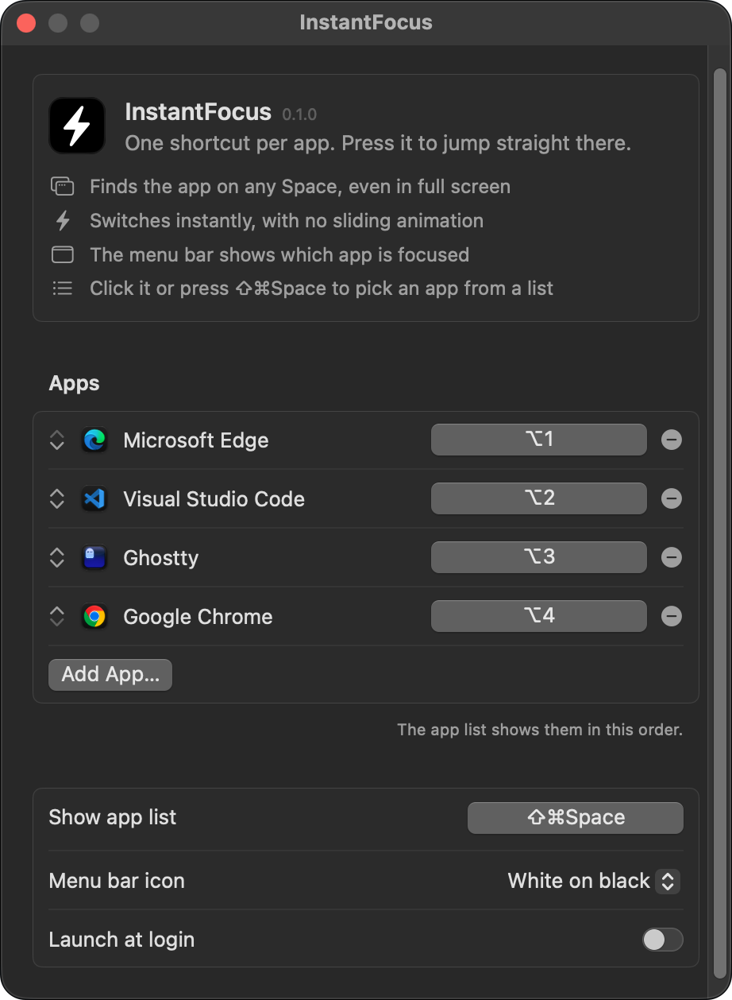
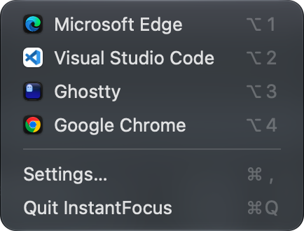
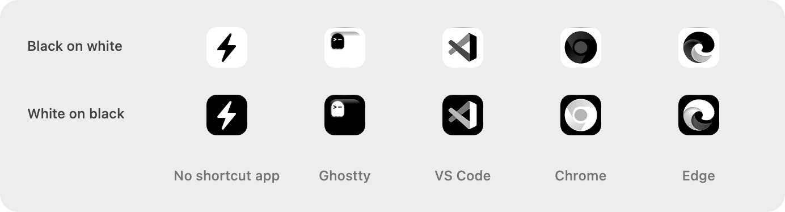

<p align="center">
  <picture>
    <source media="(prefers-color-scheme: dark)" srcset="docs/screenshots/icon-black-on-white.png">
    
  </picture>
</p>

<h1 align="center">InstantFocus</h1>

<p align="center">Jump to any app with one shortcut, on any Space or full screen, without the animation.</p>

A tiny macOS menu bar app: give each app a shortcut, press it, and you're in that app,
whether its window is on the current Space, another Space, or full screen. No slide, no
crossfade. That's all it does: trackpad swipes and other Space switching stay as macOS has them.

<p align="center">
  
  
</p>

The menu bar shows the focused app's icon when that app has a shortcut, otherwise ⚡,
drawn black on white or white on black (your choice in Settings). Click it, or press
**⌘⇧Space** (changeable in Settings), for a list of your apps: ↑ ↓ to move, Return or Space
to pick, Esc to close. Picking an app jumps to it the same instant way. The list follows the
order of the apps in Settings (reorder them with ▲ ▼).

Optional: tick **Make all app switching instant** in Settings and ⌘Tab, Dock clicks and anything
else that brings an app forward skip the Space animation too. InstantFocus turns off macOS's
"When switching to an application, switch to a Space with open windows" (Desktop & Dock) and does
that switch itself, instantly. Unticking restores the macOS setting. While InstantFocus isn't
running with this on, ⌘Tab won't take you to other Spaces.

<p align="center">
  <picture>
    <source media="(prefers-color-scheme: dark)" srcset="docs/screenshots/menubar-dark.png">
    
  </picture>
</p>

## Install

Requires macOS 13 or later (Apple Silicon or Intel).

**Homebrew**

```sh
brew install --cask vasilgen/tap/instantfocus
```

If Homebrew says the tap isn't trusted, run `brew trust --cask vasilgen/tap/instantfocus` and try again.

**Download:** grab `InstantFocus-<version>.zip` from
[Releases](https://github.com/vasilgen/instant-focus/releases), unzip it, and move
`InstantFocus.app` to Applications.

### First launch

InstantFocus isn't signed with an Apple Developer ID, so macOS warns you the first time
("Apple could not verify InstantFocus is free of malware", or "can't be opened because the
developer cannot be verified"):

1. Open it once and dismiss the warning.
2. Go to System Settings → Privacy & Security, scroll down, and click **Open Anyway** next to InstantFocus.
   (Or, in Terminal: `xattr -dr com.apple.quarantine /Applications/InstantFocus.app`.)
3. When asked, allow InstantFocus under **Accessibility**: shortcuts and switching need it.

Then add your apps and their shortcuts in the Settings window that opens.

### Updating

**Homebrew:**

```sh
brew update && brew upgrade --cask instantfocus
```

It quits InstantFocus, installs the new version, and keeps your settings. Open the app again
afterwards. (`brew update` makes Homebrew see a release right away; it only checks on its own
every so often.)

**Download:** quit InstantFocus, then replace `InstantFocus.app` in Applications with the one from
the latest [release](https://github.com/vasilgen/instant-focus/releases).

After an update, macOS treats it as a new app: repeat **Open Anyway** and the **Accessibility**
permission from [First launch](#first-launch). (If InstantFocus still shows as allowed under
Accessibility but shortcuts don't work, the app clears the old entry and asks again on launch.)

## How it works

1. A keyboard event tap catches your shortcut.
2. InstantFocus finds which Space holds the app's frontmost window, using the private
   `CGSCopySpacesForWindows` / `CGSCopyManagedDisplaySpaces` calls.
3. If that Space isn't showing, it switches there with InstantSpaceSwitcher's trick: a synthetic
   trackpad swipe with a huge velocity, so the Dock skips the animation. No SIP changes.
   With two displays, the cursor is moved onto the target display first, because ISS acts on the
   display under the cursor.
4. Once the Space is on screen, the app is activated (like `open -a`). Nothing is left to animate.

## Build from source

Requires Xcode (or the Command Line Tools).

```sh
scripts/build.sh --install    # build, ad-hoc sign, replace /Applications/InstantFocus.app, launch
```

Each rebuild changes the ad-hoc signature, so macOS forgets the Accessibility permission;
the app clears the stale entry and asks again.

Settings live in `defaults read io.github.vasilgen.InstantFocus` (`shortcuts` is a JSON string).

**Releasing:** `scripts/release.sh <version>` stamps the version, tags and pushes, builds a
universal app, publishes it on GitHub Releases, and updates the cask in
[vasilgen/homebrew-tap](https://github.com/vasilgen/homebrew-tap).

## Layout

| Path | What |
| --- | --- |
| `Sources/InstantFocus/` | The app (Swift): `Focuser` (switch + activate), `Spaces` (window → Space lookup), `HotKeys` (event tap), `MenuBarIcon`, `Store` (settings), SwiftUI settings window |
| `Sources/ISS/` | InstantSpaceSwitcher's core C code, vendored **unmodified** (MIT, see `Sources/ISS/LICENSE`) |
| `scripts/vendor-iss.sh [tag]` | Re-copy ISS's core at a given release tag (current one in `Sources/ISS/VERSION`) |
| `scripts/build.sh`, `scripts/release.sh` | Build/install locally; publish a release |
| `scripts/render-icons.sh` | Render the icon artwork in `docs/screenshots/` from the app's drawing code |
| `docs/screenshots/` | Images for the README and site, plus the shot list for manual screenshots |

## Compatibility

Developed and tested on macOS 27. Skipping the animation relies on undocumented macOS behavior
(as InstantSpaceSwitcher and yabai do), so a future macOS update could break that part. If it
does, your shortcuts still take you to the right app, just with the normal animation, until an
update fixes it.

## Credits

- **[InstantSpaceSwitcher](https://github.com/jurplel/InstantSpaceSwitcher)** by jurplel (MIT):
  the instant-switch technique. Its core C code is included as-is in `Sources/ISS`. Also the
  inspiration for the settings window and for resetting a stale Accessibility entry before prompting.
- **[yabai](https://github.com/asmvik/yabai)**: inspiration for mapping windows to Spaces with
  the private SkyLight/CGS calls. No code copied.
- **[skhd](https://github.com/asmvik/skhd)**: the `⌥1 → open -a App` workflow this replaces, and
  the event-tap approach to global hotkeys. No code copied.
- ⚡ is the `bolt` SF Symbol.

## License

MIT, see [LICENSE](LICENSE). `Sources/ISS` is InstantSpaceSwitcher's code under its own MIT license.
